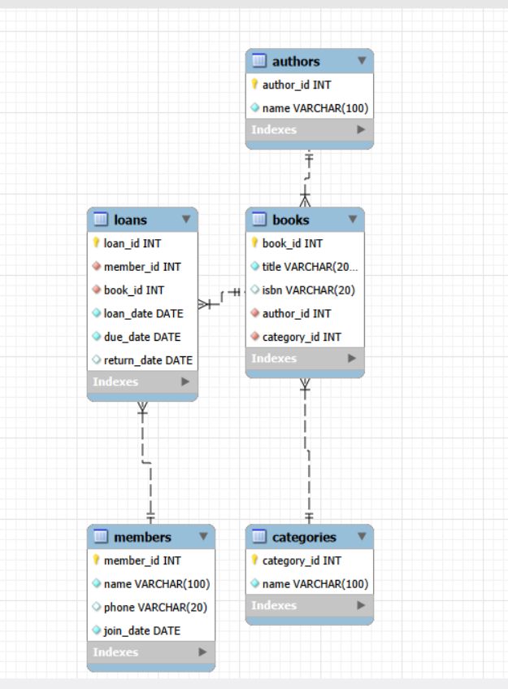

# Library Management Database

A relational database for a library system, designed and built with MySQL.

## What it does
Tracks authors, categories, books, members, and book loans, and answers
questions like: who has overdue books, which book is borrowed the most,
and how many loans each member made.

## Database design

| Table | Purpose |
|---|---|
| Authors | Book authors |
| Categories | Book categories |
| Books | Books, linked to an author and a category |
| Members | Library members |
| Loans | Which member borrowed which book, and when |

The design is in Third Normal Form (3NF): no repeated data, and every
column depends on the primary key.

## Files
- `schema.sql` - creates the database and tables
- `data.sql` - inserts sample data
- `queries.sql` - example queries (JOIN, GROUP BY, LEFT JOIN, date functions)

## How to run
1. Install MySQL Server and MySQL Workbench.
2. Run `schema.sql`, then `data.sql`.
3. Run the queries in `queries.sql`.

## Skills demonstrated
Database design, ERD, normalization, SQL (DDL, DML, JOINs, aggregation).